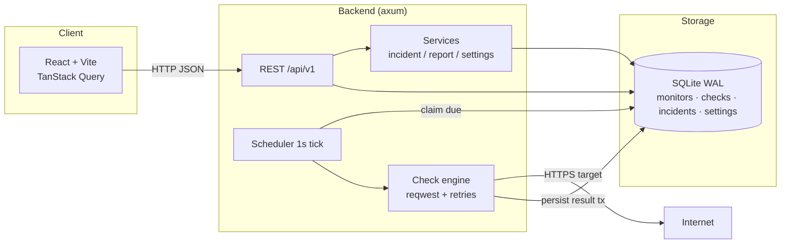

# PulseWatch

[](https://github.com/Shahbaz2104/PulseWatch/actions/workflows/ci.yml)


A full-stack website uptime monitoring platform written in **Rust** (axum + SQLite) with a **React** operations console.

PulseWatch checks URLs on a schedule, records response times and HTTP status, retries transient failures, opens and resolves incidents, and serves honest uptime/latency reports over a REST API — with a dark, instrument-style UI built for operators.


---

## Demo

<video src="docs/linkedin-demo.mp4" poster="docs/linkedin-poster.png" controls muted playsinline width="100%"></video>

[▶ Watch the 52-second walkthrough (MP4)](docs/linkedin-demo.mp4) · [Poster frame](docs/linkedin-poster.png)

The clip covers the full loop: overview → add a monitor → live first check → per-attempt history → reports → settings.

---

## Use cases

**Self-hosted uptime monitoring** — a UptimeRobot-style alternative you run yourself: watch APIs, homelab services, side projects, or client sites on your own schedule, with no per-monitor limits and no data leaving your machine. Alerts-grade raw data is exposed over REST and CSV.

**Portfolio / proof-of-work for engineers** — the codebase demonstrates production concerns end-to-end: a Tokio scheduler with atomic claim semantics and graceful shutdown, a single-transaction state machine for check → counters → incident, SSRF/DNS-rebinding hardening, honest metrics that never fabricate 100%, OpenAPI docs, and a green CI gate over 115 tests.

**Reference implementation for common patterns** — borrow the parts you need: axum + sqlx service/repository layering, exact nearest-rank percentiles, exponential backoff with full jitter and `Retry-After`, windowed report queries, or a React 19 + TanStack Query console with command palette and light/dark theming.

**API-first integration** — everything the UI does is a REST call (`/api/v1`), so it slots into scripts, dashboards, or alerting pipelines; Swagger UI ships at `/api/v1/docs`.

---

## Screenshots

| Monitors | Monitor detail |
|---|---|
|  |  |

| Reports | Light theme |
|---|---|
|  |  |

---

## Features

- **Monitors** — CRUD with per-monitor interval, timeout, retries, expected status range, and consecutive success/failure thresholds
- **Background scheduler** — 1-second tick, atomic claim (`next_check_at`), global concurrency semaphore, graceful shutdown
- **Check engine** — pooled `reqwest` client, header-arrival timing, error taxonomy (DNS / connection / timeout / TLS / status mismatch / redirects / blocked / cancelled / internal), exponential backoff with full jitter, `Retry-After` support
- **SSRF / DNS-rebinding defense** — public-IP-only policy at create time, custom DNS resolver, re-validation on every redirect hop, private targets blocked by default
- **Incidents** — transactional open/resolve on threshold transitions; partial unique index guarantees one open incident per monitor
- **Reports** — uptime (null when 0 checks, never fabricated 100%), median/p95 over successful checks only, downtime from incident durations, hourly/daily series
- **Settings API** — defaults for new monitors (env + DB override), restart-required flag for concurrency changes
- **Frontend console** — collapsible sidebar, ⌘K command palette, live polling, charts, uptime strip, CSV export, light/dark theme

---

## Architecture



### Data model (migrations/0001_init.sql)

| Table | Role |
|---|---|
| `monitors` | URL, config, current status, consecutive counters, `next_check_at` |
| `check_results` | Per-attempt outcome, HTTP status, response time, error type/message |
| `incidents` | Opened/resolved transitions with `started_at` / `resolved_at` / failure reason |
| `settings` | Key-value overrides merged over env defaults |

Indexes cover scheduler claims, windowed check aggregates, and the open-incident uniqueness constraint.

---

## Stack

| Layer | Choice |
|---|---|
| Language / runtime | Rust 1.99, Tokio |
| HTTP framework | axum 0.8 |
| Database | SQLite via sqlx 0.9 (WAL, FK on, auto-migrate) |
| HTTP client | reqwest 0.13 (custom DNS + redirect policy) |
| API docs | utoipa 6 + swagger-ui-dist at `/api/v1/docs` |
| Frontend | React 19, Vite 8, TypeScript 6, Tailwind CSS 4 |
| Client data | TanStack Query 5, React Hook Form + Zod 4 |
| Charts | Recharts + NumberFlow + Motion |

---

## Prerequisites

- Rust stable (1.99+)
- Node.js 24+ and npm
- No separate SQLite binary needed (sqlx bundles it)

---

## Setup

```bash
# 1. Backend + frontend dev deps
npm install                 # root scripts (concurrently)
npm --prefix frontend install

# 2. Configuration
cp .env.example .env        # adjust as needed

# 3. Run both (backend :3000, frontend :5173)
npm run dev
```

Open **http://localhost:5173** for the console, or **http://localhost:3000/api/v1/docs** for Swagger UI.

### Docker (API only)

```bash
docker compose up --build
# API + Swagger on http://localhost:3000
# SQLite persists in the pulsewatch-data volume
```

The image is multi-stage (`backend.Dockerfile`), non-root-ready, and includes a `/health` healthcheck. Host `frontend/dist` (from `npm --prefix frontend run build`) behind any static server for a full stack, or reverse-proxy both.

### Production-ish run

```bash
npm run build               # cargo build + vite build
# serve the backend binary; it serves the API on :3000
# host frontend/dist behind any static file server or reverse proxy
```

---

## Configuration

See `.env.example`. Important variables:

| Variable | Default | Notes |
|---|---|---|
| `HOST` / `PORT` | `127.0.0.1` / `3000` | API bind |
| `DATABASE_URL` | `sqlite://./data/pulsewatch.db` | Parent dirs created automatically |
| `DEFAULT_CHECK_INTERVAL_SECONDS` | `60` | New-monitor default (10–86400) |
| `DEFAULT_TIMEOUT_MS` | `5000` | Per-request timeout (100–60000) |
| `DEFAULT_RETRY_MAX_ATTEMPTS` | `2` | First try + retries (1–5) |
| `MAX_CONCURRENT_CHECKS` | `16` | Scheduler semaphore (1–256) |
| `ALLOWED_ORIGINS` | Vite dev origins | CORS |
| `PULSEWATCH_ALLOW_PRIVATE_TARGETS` | unset | **Tests/dev only** — allow loopback targets for wiremock |

Runtime overrides for new-monitor defaults live in the **Settings** page (persisted in the `settings` table). Changing max concurrency requires a process restart.

---

## API overview

Base path: `/api/v1`

| Method | Path | Purpose |
|---|---|---|
| GET | `/health` (also `/api/v1/health`) | Liveness + DB status |
| GET | `/openapi.json` | OpenAPI document |
| GET | `/docs` | Swagger UI |
| GET/POST | `/monitors` | List (filters + pagination) / create |
| GET/PUT/DELETE | `/monitors/{id}` | Read / update / delete (cascades) |
| POST | `/monitors/{id}/check` | Run one check now (409 if paused/in-flight) |
| POST | `/monitors/{id}/pause` \| `/resume` | Pause / resume |
| GET | `/monitors/{id}/checks` | Paginated history (`window`, `result`) |
| GET | `/monitors/{id}/checks/latest` | Newest check |
| GET | `/monitors/{id}/checks/summary` | Totals, uptime, avg/median/p95 |
| GET | `/reports/overview` | Census, uptime, series, recent activity |
| GET | `/reports/uptime` | Per-monitor uptime |
| GET | `/reports/response-times` | Latency percentiles + series |
| GET | `/reports/incidents` | Windowed incident stats |
| GET | `/incidents` · `/incidents/{id}` | Incident list / detail |
| GET/PUT | `/settings` | Effective settings / partial update |

Errors use a consistent envelope:

```json
{
  "error": {
    "code": "validation_failed",
    "message": "…",
    "details": [{ "field": "url", "message": "…" }]
  }
}
```

### Example

```bash
curl -s -X POST http://localhost:3000/api/v1/monitors \
  -H 'Content-Type: application/json' \
  -d '{"name":"Example","url":"https://example.com","check_interval_seconds":30}'

curl -s -X POST http://localhost:3000/api/v1/monitors/<id>/check
curl -s http://localhost:3000/api/v1/reports/uptime?window=24h
```

---

## Methodology

### Scheduling
- Every second the scheduler queries due monitors (`enabled = 1 AND next_check_at <= now`).
- **Atomic claim** updates `next_check_at` so a monitor is never checked twice concurrently.
- Interval is measured **from claim time**; overdue monitors after restart are checked once, not burst-caught-up.
- A shared semaphore bounds outbound concurrency; manual checks use the same path and in-flight registry.

### Checks
- Response time is measured **until response headers arrive** (not body download).
- Transient errors retry with exponential backoff + full jitter; stable status mismatches do not retry.
- 429/503 honor `Retry-After` up to a cap.
- Check result, monitor counters, and any incident transition commit in **one SQL transaction**.

### Status & incidents
```
unknown --fail(≥threshold)--> down   [opens incident]
up      --fail(≥threshold)--> down   [opens incident]
down    --success(≥threshold)--> up  [resolves incident]
any     --pause--> paused            [no checks; never reported as up]
```
UI amber **Degraded** = nominally `up` but with consecutive failures (recovery threshold not yet met).

### Uptime math
- Uptime = successful checks ÷ eligible checks × 100 over a window.
- **0 checks → `null`** (UI shows “—”), never a fake 100%.
- Latency (avg / median / p95) uses **successful checks only**; failures are excluded, never counted as 0 ms.
- Median/p95 are exact **nearest-rank** percentiles; fewer than 2 samples → `null`.
- Downtime = Σ incident durations (open incidents measured to now). Only incidents that **started** inside the window are counted.
- Paused wall-clock time is **not** excluded from uptime (v1 limitation).

### SSRF / DNS rebinding
1. Create/update validation rejects non-HTTP(S), userinfo, private/loopback/link-local/reserved IP literals, and blocklisted hostnames.
2. A custom DNS resolver filters **every resolved IP** to public ranges before connect.
3. Redirect policy re-runs structure + IP checks on every hop (max 5).
4. Environment proxies are disabled so they cannot bypass the checks.

---

## Tests

```bash
# Backend — unit + integration (temp SQLite + wiremock)
cd backend && cargo test

# Frontend — Vitest + Testing Library
cd frontend && npm test

# Full workspace
npm test

# Lint / typecheck gates
npm run lint
```

**Current counts:** **115 tests** — backend **79 tests** (47 unit + 32 integration) · frontend **36 tests** · `cargo fmt` + `clippy -D warnings` clean · `oxlint` clean · production build green.

Integration tests cover CRUD, SSRF denials, manual-check outcomes, incident open/resolve, scheduler recovery/overlap/shutdown, hand-computed report metrics, and settings validation.

---

## Honest limitations

- **Check-based uptime**, not passive probing — uptime reflects scheduled checks only.
- **Single-process scheduler** — horizontal scale-out would need a distributed lease (not implemented).
- **No authentication** — the API and console are open to whoever can reach them; put a reverse proxy + auth in front for any shared deployment.
- **Paused time is not excluded** from uptime percentages.
- **System proxies are intentionally disabled** so SSRF defenses cannot be bypassed; private targets require `PULSEWATCH_ALLOW_PRIVATE_TARGETS=true` (dev/tests only).
- SQLite is fine for a single node; multi-writer / HA would want PostgreSQL.

---

## Project layout

```
├── migrations/           # SQLx migrations
├── backend/
│   ├── src/
│   │   ├── main.rs       # bootstrap, HTTP client, graceful shutdown
│   │   ├── services/     # monitoring, incident, retry, scheduler, report, settings
│   │   ├── repositories/ # data access
│   │   ├── routes/       # axum handlers + OpenAPI
│   │   └── validation/   # SSRF policy, DNS resolver, safe client
│   └── tests/            # integration suites + common harness
└── frontend/
    └── src/
        ├── app/          # router
        ├── layouts/      # shell
        ├── pages/        # Overview, Monitors, Detail, Incidents, Reports, Settings
        ├── features/     # monitor form/actions
        ├── components/   # design system + charts
        ├── hooks/        # TanStack Query hooks
        └── lib/          # API client, formatters
```

---

## License

[MIT](LICENSE) — built as a portfolio demonstration of Rust async systems + full-stack product engineering.
